# ha-zlinky-card

[](https://www.home-assistant.io/integrations/marketplace/)
[](https://github.com/juju35/ha-zlinky-card/actions/workflows/hacs.yml)
[](https://github.com/juju35/ha-zlinky-card/actions/workflows/validate.yml)
[](https://github.com/juju35/ha-zlinky-card/actions/workflows/lint.yml)
[](https://github.com/juju35/ha-zlinky-card/releases/latest)
[](https://github.com/juju35/ha-zlinky-card/blob/main/LICENSE)
[](https://buymeacoffee.com/julienstep9)

Custom Lovelace card for the [LiXee ZLinky_TIC](https://lixee.fr/) Zigbee module, which reads the French **Linky** smart meter's TIC output, in Home Assistant (through [ZHA](https://www.home-assistant.io/integrations/zha/) or [Zigbee2MQTT](https://www.zigbee2mqtt.io/devices/ZLinky_TIC.html)).

Pick the ZLinky, the card finds all its entities by itself.

[](https://my.home-assistant.io/redirect/marketplace_repository/?owner=juju35&repository=ha-zlinky-card&category=plugin)

While the meter is online, the card animates: the LED blinks and glows, faster as power rises. It settles to a still card when offline (and honours `prefers-reduced-motion`).

| | Light | Dark |
|---|---|---|
| Normal load — green gauge, slow LED blink | 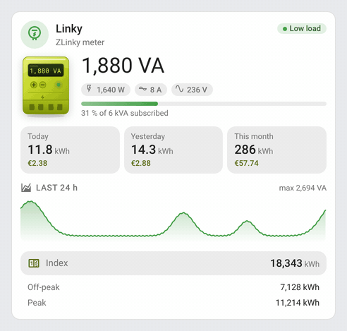 | 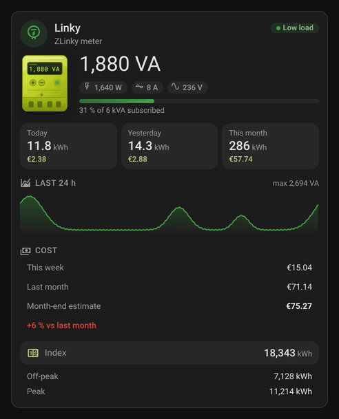 |
| High load — red gauge, fast LED blink near the subscribed power | 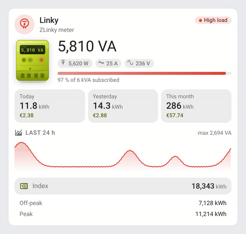 | 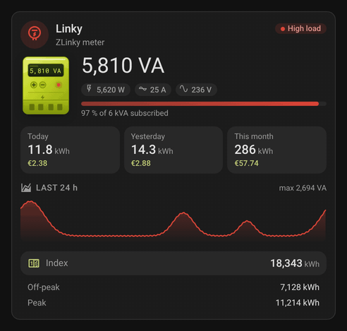 |

| Card | Dark theme |
|---|---|
| 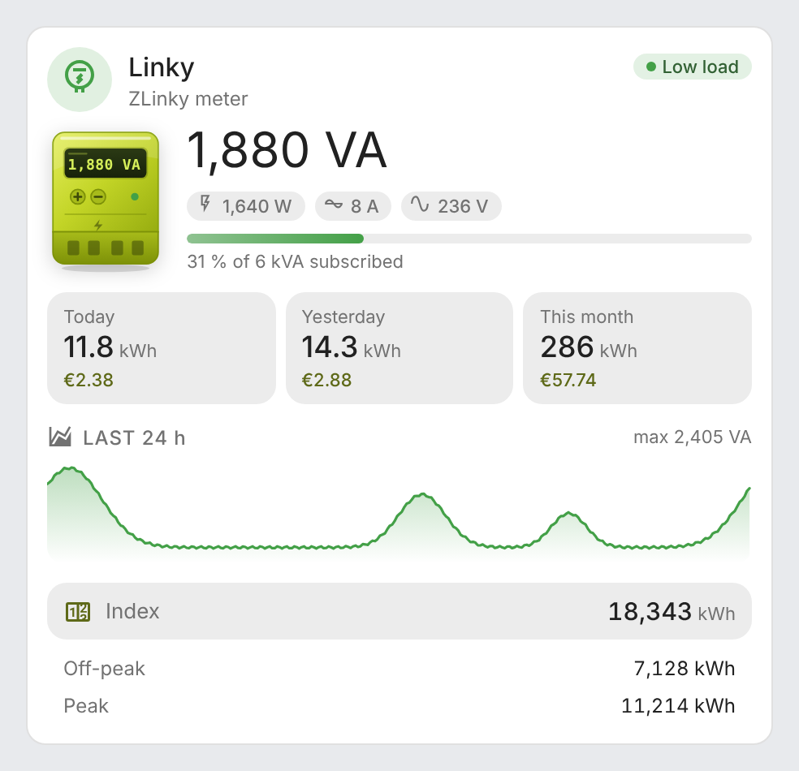 | 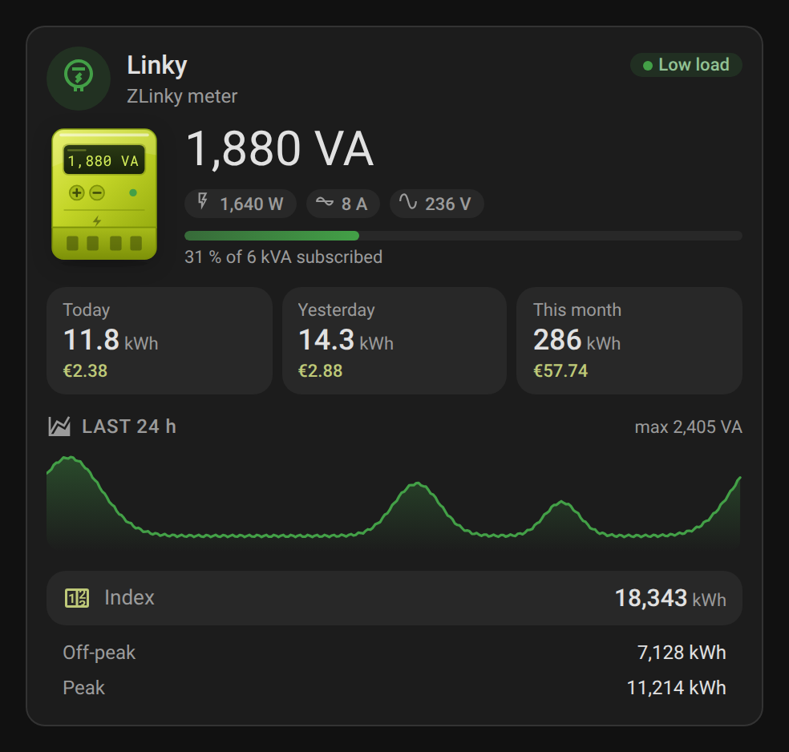 |

| Tempo contract | Tempo contract, dark theme |
|---|---|
| 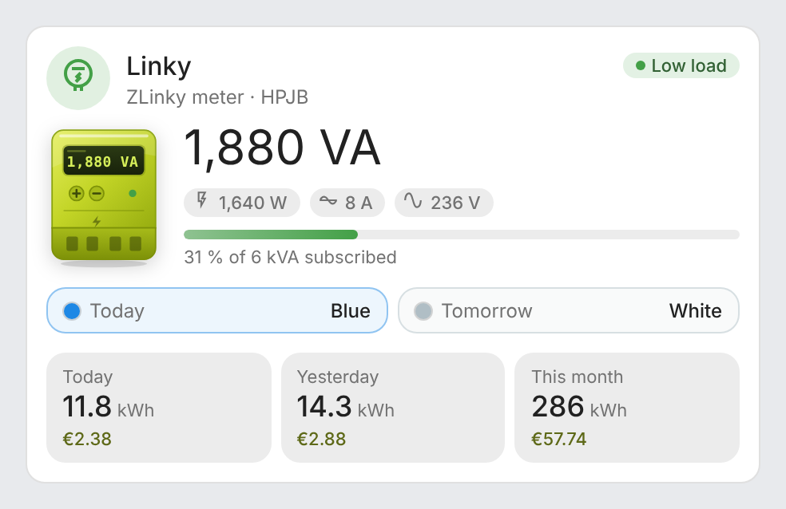 | 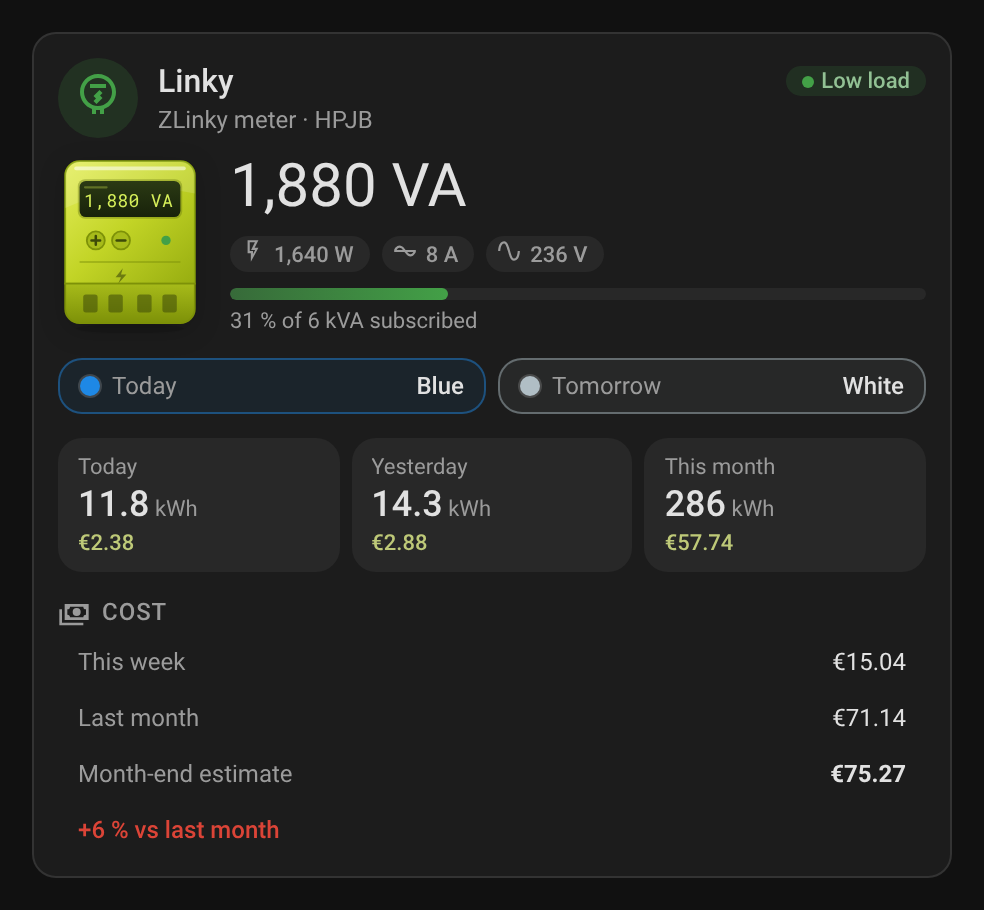 |

| Mini card | Mini card, dark theme |
|---|---|
| 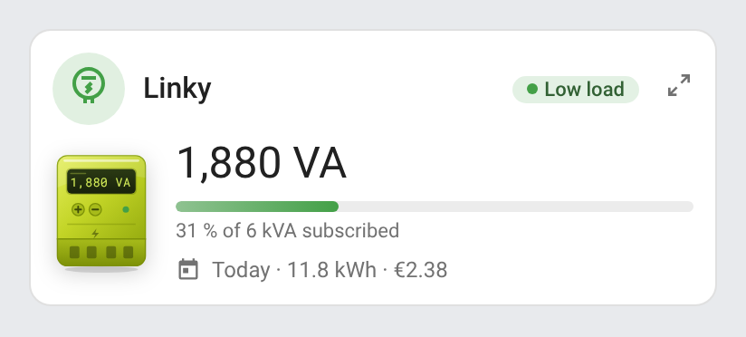 | 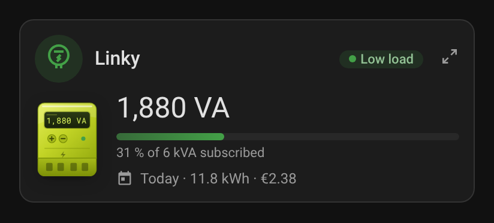 |
| 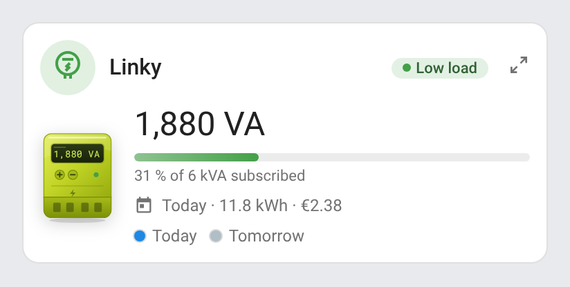 | 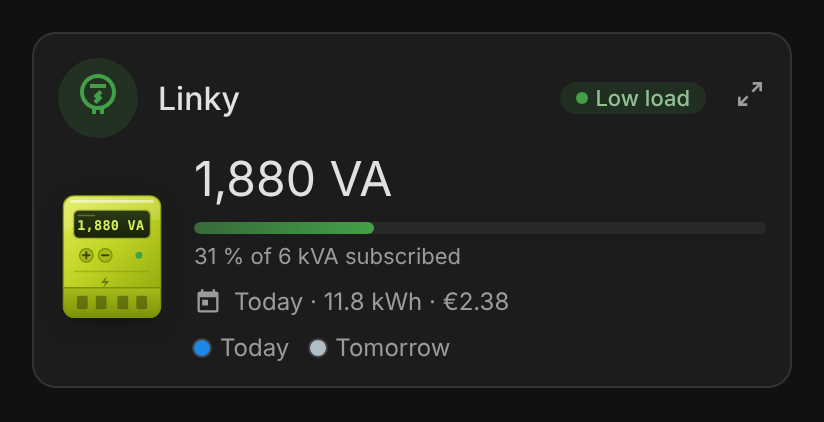 |

## Features

- Two cards: `zlinky-card` and its mini version `zlinky-mini-card` (compact, a detail button unfolds the full card)
- Automatic discovery of the ZLinky and its entities (ZHA with English or French entity IDs, Zigbee2MQTT TIC labels), each entity can be overridden
- Live apparent power (or active power), with active power, current and voltage
- Load gauge against your subscribed power (kVA, a number or a sensor), colored green / orange / red (thresholds adjustable)
- **Today**, **yesterday** and **this month**'s consumption from Home Assistant's long-term statistics, with the cost when a price per kWh is set
- 24 h power curve with its peak (the highest reading, not the highest 5-minute mean), on a real time axis (a gap in the recorder's data shows as a break in the line)
- Tempo contract: today's color (from the tariff period) and tomorrow's once announced (from `DEMAIN`, or any sensor naming a color)
- Contract comparison: your last 12 months of hourly consumption priced as Base and as Off-peak / Peak, with your prices and off-peak hours — which contract would have cost less, and by how much
- Meter index, the tiers in use (off-peak / peak, Tempo… named as you like) and the injection index when you produce
- Three-phase details on three-phase meters: apparent power (VA) and voltage per phase with the standard TIC (`SINSTS1`–`SINSTS3`), else current per phase, currents only with the historic TIC (`IINST1`–`IINST3`)
- An animated Linky meter: its screen shows the live power and its LED blinks faster as the load rises
- Tap any value to open its history
- Visual editor in the dashboard UI (no YAML needed)
- English, French, German, Spanish, Serbian (Cyrillic and Latin), Italian, Dutch, European Portuguese, Polish, Romanian, Danish, Swedish, Bulgarian, Russian, Ukrainian, Hungarian, Slovak, Czech, Slovenian, Latvian and Greek, follows the Home Assistant language
- Light and dark theme compatible
- Single file, no dependencies, ready for the Marketplace

## Supported integrations

| Integration | What the cards read |
|---|---|
| [ZHA](https://www.home-assistant.io/integrations/zha/) (built in) | The ZLinky_TIC entities, English or French entity ids |
| [Zigbee2MQTT](https://www.zigbee2mqtt.io/devices/ZLinky_TIC.html) | The ZLinky_TIC entities, by their TIC labels |

Both expose the same data to the cards: live power, current and voltage, load against the subscribed power, consumption and cost from the long-term statistics, meter index and tiers, injection, three-phase details.

## Prerequisites

- Home Assistant 2024.8 or later
- A ZLinky_TIC paired with ZHA or Zigbee2MQTT
- The consumption tiles use the recorder's statistics: the energy sensors need a `state_class` (the ZLinky's have one). The curve uses the power sensor's statistics too, or, when it has none, its state history from the recorder

## Installation

### Via the Marketplace (recommended)

Click the button below to add the repository directly:

[](https://my.home-assistant.io/redirect/marketplace_repository/?owner=juju35&repository=ha-zlinky-card&category=plugin)

Or manually:

1. Open **Settings → Marketplace → Add from link** (top right; this needs a GitHub account connected)
2. Add `https://github.com/juju35/ha-zlinky-card` — Category: **Dashboard** (Lovelace)
3. Open **ZLinky Card** and click **Install**
4. Clear your browser cache and refresh

The Marketplace registers the dashboard resource for you.

### Manual

1. Download `zlinky-card.js` and the `zlinky-card.i18n.*.js` translation files from the [latest release](https://github.com/juju35/ha-zlinky-card/releases/latest)
2. Copy them all to `/config/www/` (without the translation files, the cards show in English)
3. Go to **Settings → Dashboards → Resources** → Add resource:
   - URL: `/local/zlinky-card.js`
   - Type: **JavaScript Module**
4. Clear your browser cache and refresh

## Configuration

### Visual editor

Add the card from the dashboard (**Add card** → **ZLinky Card**). The first ZLinky found is picked automatically; change it with the **ZLinky** field, then set the subscribed power, the price and the sections to show. The **Entities (advanced)** panel lets you force any entity if auto-detection picks the wrong one: when none of the meter's sensors is recognised, the card says so ("No ZLinky sensor found") instead of showing the meter offline. Options left at their default are not written to the YAML.

### Minimal

```yaml
type: custom:zlinky-card
```

### Mini card

```yaml
type: custom:zlinky-mini-card
subscribed_power: 9
```

The mini card shows the meter, the live power, the load gauge, today's consumption (hidden with `show_stats: false`) and, on a Tempo contract, today's and tomorrow's colors as two dots (hidden with `show_tempo: false`). The detail button (top right) unfolds the full card; a click anywhere else on the page folds it back. It takes the same options as the full card, plus `zoom`.

In the Sections view, the mini card fits 6 columns (half a section, down to about 156 px on a phone): on a narrow card the meter gets smaller, the reading scales down, today's line wraps and the status pill keeps its colored dot only (the status stays in its tooltip). The full card needs 9 columns at least.

| Mini card, 180 px | Dark theme |
|---|---|
| 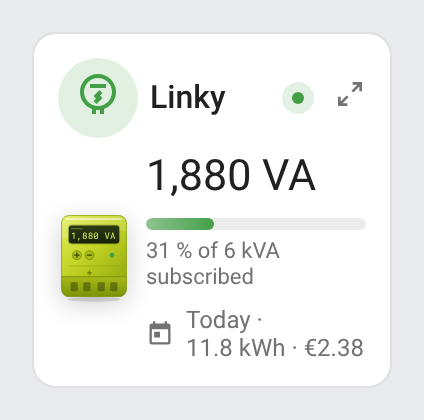 | 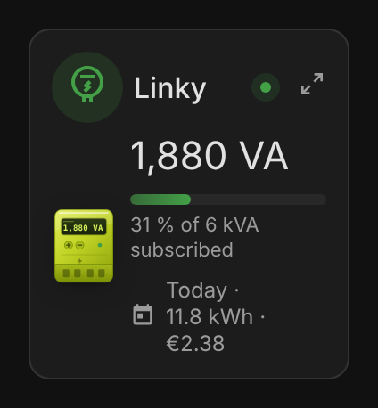 |

### Full options

```yaml
type: custom:zlinky-card
device_id: a9b4cb527f0afb6cf4988dd5a3eee88b
name: Linky
subscribed_power: 9
load_warning: 50
load_critical: 80
price: 0.2016
tiers:
  - Off-peak
  - Peak
show_stats: true
show_graph: true
show_index: true
show_phases: true
show_logo: true
language: en
entities:
  apparent_power: sensor.lixee_zlinky_tic_puissance_apparente
  energy: sensor.lixee_zlinky_tic_consommation
```

### Options reference

| Option | Required | Default | Description |
|---|---|---|---|
| `device_id` | ❌ | Auto | ZLinky device (the first ZLinky found is used if missing) |
| `entity` | ❌ | — | Any entity of the ZLinky, used to find the device |
| `name` | ❌ | `Linky` | Card title |
| `icon` | ❌ | Illustration | Replaces the meter illustration with an icon |
| `subscribed_power` | ❌ | `6` | Subscribed power for the load gauge: a number in kVA, or a sensor giving it (in kVA, or in A like the historic TIC's `ISOUSC`: 1 A = 0.2 kVA). In the visual editor, the **Subscribed power sensor** field replaces the number |
| `load_warning` | ❌ | `50` | Share of the subscribed power (%) from which the load is moderate (orange) |
| `load_critical` | ❌ | `80` | Share of the subscribed power (%) from which the load is high (red) |
| `price` | ❌ | — | Price per kWh, shows the cost of each consumption (currency from Home Assistant): a number, a sensor giving the current price per kWh, or [one price per tier](#price-per-tier) |
| `tiers` | ❌ | `Index 1`… | Names of the tiers, in order (`[Off-peak, Peak]`, Tempo colors…) |
| `show_stats` | ❌ | `true` | Today / yesterday / this month |
| `show_graph` | ❌ | `true` | 24 h power curve |
| `show_index` | ❌ | `true` | Meter index, tiers and injection |
| `show_phases` | ❌ | `true` | Per-phase details (three-phase meters only) |
| `show_logo` | ❌ | `true` | Meter icon in the header |
| `show_tempo` | ❌ | `true` | Tempo colors of today and tomorrow (only on a Tempo contract; two dots on the mini card) |
| `compare_base` / `compare_hc` / `compare_hp` | ❌ | — | Full card: the Base price and the Off-peak and Peak prices per kWh, for the [contract comparison](#contract-comparison) (all three and `hc_hours` turn it on) |
| `hc_hours` | ❌ | — | Off-peak hours for the comparison, such as `22:30-06:30` or `01:00-07:00, 12:30-14:30` |
| `sub_base` / `sub_hchp` | ❌ | — | Monthly subscription of each contract, added to the comparison |
| `zoom` | ❌ | `true` | Mini card only: detail button that unfolds the full card |
| `language` | ❌ | HA language | `en`, `fr`, `de`, `es`, `sr`, `sr-Latn`, `it`, `nl`, `pt`, `pl`, `ro`, `da`, `sv`, `bg`, `ru`, `uk`, `hu`, `sk`, `cs`, `sl`, `lv` or `el` |
| `entities` | ❌ | Auto | Override any detected entity: `energy`, `power`, `apparent_power`, `current`, `voltage`, `current_b`, `current_c`, `voltage_b`, `voltage_c`, `apparent_power_a`, `apparent_power_b`, `apparent_power_c` (apparent power per phase, SINSTS1…3), `injection`, `tariff`, `tempo` (today's Tempo color, e.g. from an RTE Tempo integration), `tomorrow` (tomorrow's Tempo color), `tier1`…`tier6` |

### Price per tier

On an off-peak / peak, Tempo or EJP contract, give `price` one price per tier, in the order of the meter's indexes (the same order as `tiers` and `tier1`…`tier6`). Each consumption tile then adds up each tier's kWh × its price, from the long-term statistics of each tier's index. An entry can also be a sensor giving the price per kWh (e.g. from your energy provider's integration). In the visual editor, the **Price per tier** field takes one value per line and replaces the single **Price per kWh** field.

```yaml
# Off-peak / peak (HC, HP)
price: [0.1696, 0.2146]
tiers: [Off-peak, Peak]
```

```yaml
# Tempo, in the TIC order: HCJB, HPJB, HCJW, HPJW, HCJR, HPJR
price: [0.1296, 0.1609, 0.1486, 0.1894, 0.1568, 0.7562]
```

```yaml
# EJP (normal, peak), the peak price from a sensor
price: [0.1528, sensor.ejp_peak_price]
```

A tier without a price (a shorter list) takes the last price of the list; a sensor that is unavailable takes the closest price before it (or the first one). When only the total index has statistics (a single tier in use, or a tier's statistics missing), every kWh of the period is priced at the current tier's price, read from the tariff period (`HC..`, `HPJB`, `HP BLEU`, `PM..`, a tier number, or one of your `tiers` names), or at the first price. Yesterday's and this month's tiles then show no cost when the tiers' prices differ (the current tier's price says nothing of the tiers that period was spent in); today's cost stays an estimate at the current tier's price.

The Tempo colors show when the tariff period names one (`HPJB`, `HC JR`, `HP BLEU`…); tomorrow's reads *Not known yet* until it is announced. Tiers are listed only when more than one carries an index. The phase section appears when phases 2 or 3 report a voltage, or, with the historic TIC (no voltage per phase), when the phase 2 and 3 currents are there. The Zigbee2MQTT distributor indexes `EASF07`–`EASF10` are not mapped: every standard French contract (Base, off-peak/peak, Tempo) fits in `tier1`…`tier6`.

### Contract comparison

Base or Off-peak / Peak? Give both contracts' prices and your off-peak hours (in the visual editor: **Compare Base and Off-peak**), and the full card prices your last 12 months of consumption both ways, from the hourly long-term statistics of the total index (one query every 6 hours):

```yaml
compare_base: 0.1952
compare_hc: 0.1635
compare_hp: 0.2081
hc_hours: 22:30-06:30
sub_base: 15.65
sub_hchp: 16.08
```

| Contract comparison | Contract comparison, dark theme |
|---|---|
| 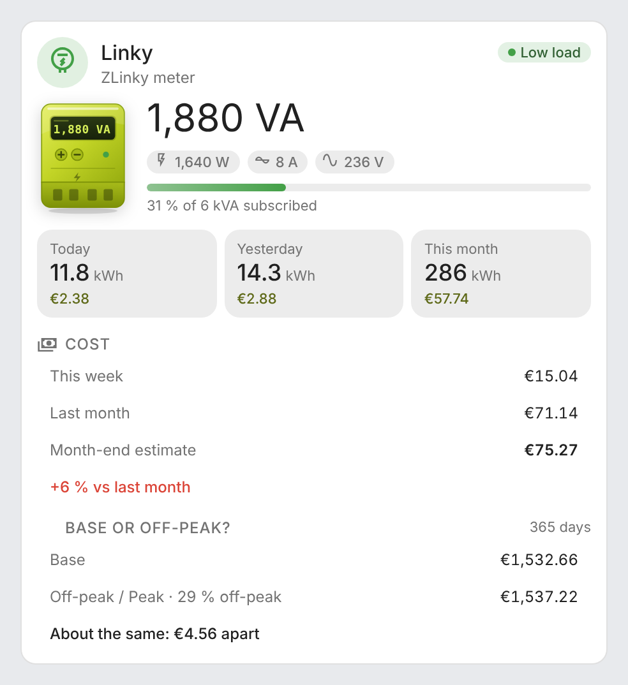 | 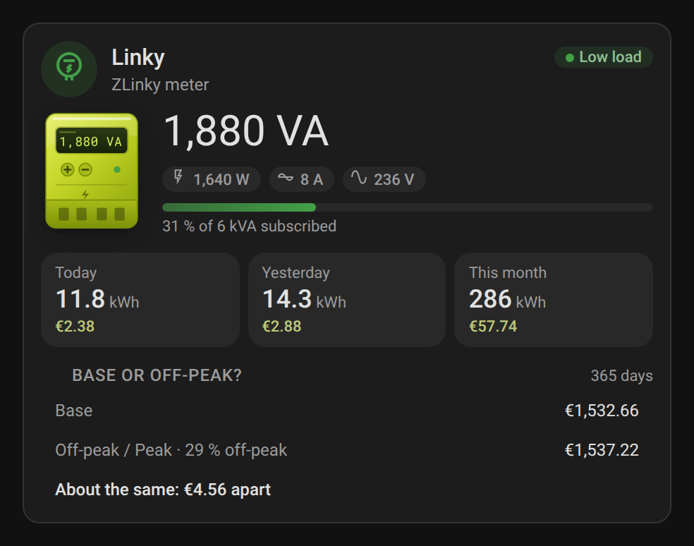 |

The section shows each contract's cost, the share of your consumption in off-peak hours and which one saves how much (*About the same* when they are less than 2 % apart), over the days the statistics cover (fewer than 365 the first year). Hours are read in Home Assistant's time zone; an hour counts as off-peak when its middle is (hourly statistics can't split 22:30). Tempo isn't compared: its cost depends on each past day's color, which the meter doesn't keep — on a Tempo contract, the consumption tiles already price each color with [one price per tier](#price-per-tier).

## Development

```bash
npm run build        # builds dist/zlinky-card.js
npm test             # unit tests
npm run screenshots  # regenerates the README screenshots and the live GIFs (Playwright + ffmpeg)
```

## Translations

The cards auto-detect the language from your Home Assistant settings. Currently supported:

| Language | Code |
|---|---|
| English | `en` |
| Français | `fr` |
| Deutsch | `de` |
| Español | `es` |
| Српски | `sr` |
| Srpski (latinica) | `sr-Latn` |
| Italiano | `it` |
| Nederlands | `nl` |
| Português (Portugal) | `pt` |
| Polski | `pl` |
| Română | `ro` |
| Dansk | `da` |
| Svenska | `sv` |
| Български | `bg` |
| Русский | `ru` |
| Українська | `uk` |
| Magyar | `hu` |
| Slovenčina | `sk` |
| Čeština | `cs` |
| Slovenščina | `sl` |
| Latviešu | `lv` |
| Ελληνικά | `el` |

Other regional variants fall back to their base language (`pt-BR` uses the European Portuguese texts, `nl-BE` Dutch), and unsupported languages to English.

## License

[MIT](https://github.com/juju35/ha-zlinky-card/blob/main/LICENSE)

## Support

If you find this project useful, you can support its development:

<a href="https://buymeacoffee.com/julienstep9"></a>
